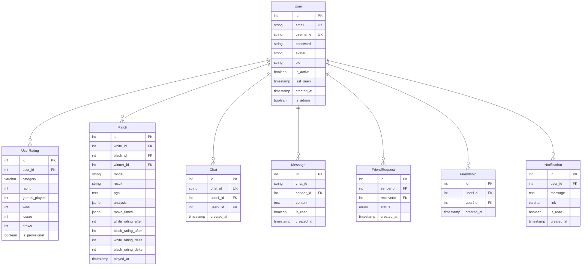

*This project has been created as part of the 42 curriculum by armarake, haaghaja, nasargsy.*

# ft_transcendence — Real-Time Online Chess Platform

## Description

**ft_transcendence** is a full-stack, real-time online chess web application built as the final project of the 42 Common Core. The goal of the project is to provide a complete, responsive, multi-user competitive chess platform where players can match online, challenge friends, spectate live games, track Elo progression across time controls, chat in real time, and review finished matches with a dedicated Stockfish analysis engine.

### Key Features

- **Real-Time Online Chess**: Server-authoritative chess rules (`chess.js`), 6 time controls (Bullet `1+0` / `1+2`, Blitz `3+0` / `3+2`, Rapid `10+0` / `10+2`), automated matchmaking queue, direct friend challenges, draw offers, resignations, rematches, premoves, pawn promotion, and sound effects.
- **Disconnect Pause & Reconnection**: Automatic grace-period pause when a remote player disconnects, live countdown broadcast to both clients, and seamless state restoration upon reconnect.
- **Live Spectator Mode**: Real-time game spectating from user profiles or direct game links, with live clocks, move log updates, and board flipping.
- **Stockfish Game Analysis & Review**: Dedicated Stockfish UCI engine service providing Multi-PV evaluation lines, visual evaluation bar, move classification (Brilliant, Best, Excellent, Good, Inaccuracy, Mistake, Blunder), per-player accuracy percentages, PGN import, and automatic post-game review.
- **Elo Ratings, Statistics & Leaderboard**: Separate Bullet, Blitz, and Rapid Elo ratings with 5-game provisional calibration, interactive rating history charts, match history, Top-3 podium badges, and a searchable/filterable/sortable paginated global leaderboard.
- **Social & User Management**: JWT + bcrypt authentication, customizable profiles with avatar uploads, friend requests and real-time online/in-game/offline presence, direct WebSocket chat with read receipts, and real-time notifications.
- **Internationalization & Legal Pages**: Full UI translation in English (`en`), Russian (`ru`), and Armenian (`hy`), plus accessible Privacy Policy (`/privacy`) and Terms of Service (`/terms`) pages.
- **Admin Backoffice**: Protected AdminJS dashboard (`/admin`) for administrative database inspection and management.

---

## Instructions

### Prerequisites

- **Docker** (v24+ recommended) and **Docker Compose** (`docker compose` v2)
- **GNU Make** (optional, for shortcut commands in `Makefile`)
- A modern web browser (**Google Chrome**, **Mozilla Firefox**, or **Microsoft Edge**)

> All runtime dependencies (Node.js 20, PostgreSQL 15, Nginx Alpine, Stockfish native binary) are built and managed inside Docker containers.

### Environment Configuration

1. Clone the repository and move into the project root:

```bash
git clone <repository-url>
cd ft_transcendence
```

2. Create a local `.env` file from `.env.example`:

```bash
cp .env.example .env
```

3. Fill in all required values in `.env` (this file is ignored by Git):

```env
# PostgreSQL / Database
DB_HOST=db
DB_PORT=5432
POSTGRES_USER=postgres
POSTGRES_PASSWORD=your_secure_db_password
POSTGRES_DB=ft_transcendence

# Backend
JWT_SECRET=your_long_random_jwt_secret

# Admin panel
ADMIN_COOKIE_PASSWORD=your_long_random_admin_cookie_secret
```

### Running the Application

#### Production Mode (Single Command)

```bash
make
```

Or directly with Docker Compose:

```bash
docker compose up --build -d
```

This builds and starts four containers (`nginx`, `backend`, `engine`, `db`):
- **Web Application (HTTPS)**: `https://localhost:8080`
- **Admin Panel (HTTPS, admin users only)**: `https://localhost:8080/admin`

> Because Nginx generates a self-signed TLS certificate (`TLSv1.2` / `TLSv1.3`) for `localhost`, your browser will display a certificate warning on first visit; accept it to proceed over HTTPS.

#### Development Mode (HMR & Live Reload)

```bash
make dev
```

#### Useful Makefile Commands

| Command | Description |
|---|---|
| `make` / `make start` | Build and start all services in production mode (detached) |
| `make up` | Build and start production services in foreground |
| `make dev` | Start development stack with Vite HMR and NestJS watch mode |
| `make dev-logs` | Stream development container logs |
| `make logs` | Stream production container logs |
| `make down` | Stop and remove running containers |
| `make re` | Full rebuild and restart |

---

## Team Information

Our team consists of 3 members from 42 Yerevan. Every member served as a developer while also taking ownership of one of the required project management roles:

| Login | Name | Assigned Roles | Responsibilities |
|---|---|---|---|
| `haaghaja` | Hakob Aghajanyan | **Product Owner (PO)**, Developer | Defined product vision and feature priorities, maintained the backlog, validated completed features, and built the initial container/project structure, user & authentication system, real-time chat, friends, notifications, and i18n foundation. |
| `nasargsy` | Narek Sargsyan | **Project Manager (PM) / Scrum Master**, Developer | Coordinated sprint progress, tracked deadlines and blockers, organized sync meetings, and engineered the Stockfish analysis microservice, move classification/accuracy system, rating history analytics, and global leaderboard. |
| `armarake` | Arman Arakelyan | **Technical Lead / Architect**, Developer | Defined frontend/backend technical architecture, reviewed critical code changes, maintained design-system consistency, and implemented the real-time chess engine loop, matchmaking, WebSocket game synchronization, reconnection logic, spectator mode, and modular frontend architecture. |

---

## Project Management

- **Task Organization & Work Breakdown**: Features and bugs were broken down into discrete tasks tracked via **GitHub Issues** and organized across workflow stages on a shared **Trello** board.
- **Meetings & Cadence**: The team held formal sync meetings at least **once a month** to review milestones, align on architecture decisions, and reprioritize the backlog, complemented by continuous asynchronous coordination.
- **Communication Channel**: **Telegram** was used for daily coordination, quick technical discussions, and review notifications.
- **Git Workflow**: Feature-based development with clear commit history across all team members and cross-member reviews on critical changes.

---

## Technical Stack

### Frontend
- **React 19** + **TypeScript** + **Vite 8**: Component-based SPA architecture with fast builds and type safety.
- **React Router 7**: Client-side routing across public, authenticated, game, and legal layouts.
- **Tailwind CSS v4** + **CSS Modules** + **Custom Design Tokens** (`frontend/src/index.css`): Consistent visual system with scoped component styling and responsive mobile-first layouts.
- **Socket.IO Client**: Persistent real-time connections for gameplay, presence, chat, challenges, and notifications.
- **chess.js**: Client-side legal move generation, FEN/PGN parsing, and board state validation.
- **Recharts**: Interactive Elo rating progression charts.
- **i18next** / **react-i18next**: Multi-language support (`en`, `ru`, `hy`) with browser language detection.
- **Lucide React**: Consistent SVG icon set.

### Backend
- **NestJS 11** + **TypeScript**: Modular, dependency-injected server architecture with controllers, services, guards, and WebSocket gateways.
- **Socket.IO** (`@nestjs/platform-socket.io`): Dedicated namespaces (`/game`, `/chat`, `/friends`, `/challenge`) for isolated real-time traffic.
- **TypeORM**: Typed ORM managing PostgreSQL schemas, relations, and queries.
- **Passport + JWT + bcrypt**: Stateless token authentication and salted password hashing.
- **Multer**: Validated avatar file upload handling.
- **AdminJS**: Built-in administrative panel at `/admin` restricted to `is_admin` accounts.

### Analysis Engine Microservice
- **Node.js 20** + **Express** + **TypeScript** + **Stockfish (UCI)**: Isolated container (`engine/`) spawning the native Stockfish binary over UCI to run Multi-PV position evaluation (`/evaluate`) and full-game PGN analysis (`/analyze`) without blocking the main NestJS event loop.

### Database & Infrastructure
- **PostgreSQL 15**: Chosen for strict relational integrity across users, matches, ratings, friendships, chats, and notifications, combined with native `jsonb` columns for structured Stockfish analysis payloads and per-move timestamps.
- **Nginx (Alpine)**: Single HTTPS entry point (`TLSv1.2` / `TLSv1.3` on port `443`, mapped to host `8080`), serving the compiled React SPA, enforcing request body limits, and reverse-proxying `/api/`, `/socket.io/`, `/uploads/`, and `/admin`.
- **Docker & Docker Compose**: Reproducible single-command deployment across isolated containers on a bridge network.

---

## Database Schema

PostgreSQL stores 8 core tables managed via TypeORM entities in `backend/src/`:



### Table Summary

- **`user`**: Account credentials (`bcrypt`-hashed password), profile metadata (`avatar`, `bio`), presence tracking (`is_active`, `last_seen`), and `is_admin` flag.
- **`user_rating`**: Unique per `(user_id, category)` (`bullet`, `blitz`, `rapid`); tracks Elo rating (default `800`), games played, wins/losses/draws, and `is_provisional` (true for first 5 games).
- **`match`**: Stores live and completed games, time-control `mode`, outcome `result`, full `pgn`, cached Stockfish `analysis` (`jsonb`), `move_times` (`jsonb`), and post-game Elo snapshots/deltas.
- **`chat`** & **`message`**: Deterministic 1-on-1 chat rooms (`chat_id`) and persisted message history with `is_read` status.
- **`friend_request`** & **`friendship`**: Pending/accepted/rejected friend requests and unique bidirectional friendship pairs.
- **`notification`**: Persisted user notifications with localized JSON message payloads, navigation `link`, and read state.

---

## Features List

| Feature | Description | Team Member(s) |
|---|---|---|
| **Authentication & User Profiles** | Registration, login, JWT guards, password change, profile bio editing, avatar upload with default fallback, and public profile views. | `haaghaja`, `armarake` |
| **Real-Time Chess Gameplay** | Interactive board (drag-and-drop & click-to-move), legal move hints, premoves, pawn promotion overlay, live chess clocks, sound effects, draw offers, resign, and rematch. | `armarake` |
| **Matchmaking & Friend Challenges** | Queue-based matchmaking across 6 time controls (`bullet`, `blitz`, `rapid`, with/without `+2s` increment) plus real-time direct friend challenges. | `armarake` |
| **Remote Play & Reconnection** | Server-side disconnect detection, automatic clock pause, mode-based grace period countdown, and full state recovery when reconnecting. | `armarake` |
| **Live Spectator Mode** | Watch ongoing matches in real time with synced clocks, move history, player banners, and viewer board orientation toggle. | `armarake` |
| **Stockfish Game Analysis** | Dedicated Stockfish UCI engine microservice, interactive analysis board, Multi-PV best-line display, evaluation bar, move classifications, accuracy scores, and PGN import. | `nasargsy`, `armarake` |
| **Elo Ratings & Rating History** | Mode-specific Elo calculation, 5-game calibration phase, mini profile charts, and full interactive multi-mode rating history page. | `nasargsy`, `armarake` |
| **Global Leaderboard & Search** | Global rankings with Top-3 podium, debounced player search, filters (mode, minimum win rate, online/in-game status), multi-column sorting, and server-side pagination. | `nasargsy` |
| **Real-Time Chat** | 1-on-1 direct messaging over WebSockets, persistent message history, unread counters, read receipts, and profile navigation. | `haaghaja` |
| **Friends & Live Presence** | Send/accept/reject friend requests, remove friends, search friends list, and see live `ONLINE` / `INGAME` / `OFFLINE` status updates. | `haaghaja`, `armarake` |
| **Notifications** | Real-time bell notifications for friend requests/acceptances, challenge popups, and toast alerts. | `haaghaja`, `armarake` |
| **Trilingual Internationalization** | Complete `en`, `ru`, and `hy` translations with persistent language switcher in the navigation bar. | `haaghaja`, `armarake`, `nasargsy` |
| **Legal & Info Pages** | Accessible Privacy Policy (`/privacy`), Terms of Service (`/terms`), and About (`/about`) pages linked from the footer and navbar. | `armarake`, `haaghaja` |
| **AdminJS Panel** | Authenticated admin backoffice at `/admin` for CRUD inspection of all database entities. | `nasargsy`, `haaghaja` |

---

## Modules

### Point Calculation Summary

The subject requires **14 mandatory points** (`Major = 2 pts`, `Minor = 1 pt`), with up to **5 bonus points** (maximum countable score: **19 points**).

| Type | Count | Points |
|---|---|---|
| Major Modules | 7 | 14 pts |
| Minor Modules | 7 | 7 pts |
| **Total Claimed** | **14** | **21 pts (capped at 19 / 19)** |

---

### Major Modules (2 pts each)

1. **Web — Use a framework for both the frontend and backend (2 pts)**
   - *Why chosen*: Provides structured architecture, type safety, routing, and modular scalability across the stack.
   - *Implementation*: **React 19** (Vite + React Router + TypeScript) on the frontend and **NestJS 11** (TypeScript + Express + modular DI) on the backend.
   - *Contributors*: `haaghaja`, `armarake`, `nasargsy`.

2. **Web — Implement real-time features using WebSockets (2 pts)**
   - *Why chosen*: Essential for low-latency chess moves, live clocks, presence, chat, and notifications.
   - *Implementation*: **Socket.IO** gateways across 4 dedicated namespaces (`/game`, `/chat`, `/friends`, `/challenge`) with room-targeted broadcasting (`gameId`, `user_<id>`) and graceful connection/disconnection lifecycle handling.
   - *Contributors*: `armarake`, `haaghaja`.

3. **Web — Allow users to interact with other users (2 pts)**
   - *Why chosen*: Builds a social competitive community around matches.
   - *Implementation*: Complete 1-on-1 real-time chat (`ChatModule`, `MessagesModule`, `ChatPage`), public user profiles (`ProfilePage`), and friends management (`FriendsModule`, `FriendsList`).
   - *Contributors*: `haaghaja`, `armarake`.

4. **User Management — Standard user management and authentication (2 pts)**
   - *Why chosen*: Core security and identity layer for ratings, friends, and persistent match history.
   - *Implementation*: Email/password signup and login with `bcrypt` hashing and JWT authentication (`AuthModule`, `JwtAuthGuard`), profile editing (`SettingsPage`), `multer` avatar upload with default fallback, and live online/in-game status (`PresenceService`).
   - *Contributors*: `haaghaja`, `armarake`.

5. **Gaming and User Experience — Implement a complete web-based game (2 pts)**
   - *Why chosen*: Chess is the central product experience of the platform.
   - *Implementation*: Full server-authoritative 2D Chess (`chess.js`) supporting 6 time controls, matchmaking queue, friend challenges, promotion, clocks, checkmate, stalemate, insufficient material, repetition/agreement draws, resignation, timeout, and rematch.
   - *Contributors*: `armarake`.

6. **Gaming and User Experience — Remote players (2 pts)**
   - *Why chosen*: Enables real-time matches across separate devices while tolerating real-world network drops.
   - *Implementation*: Socket.IO `/game` synchronization with server-side disconnect detection in `GameService`, automatic game pause and clock freeze, shared grace-period countdown timer, and full game-state restoration on reconnect.
   - *Contributors*: `armarake`.

7. **Modules of Choice — Stockfish Chess Analysis Engine & Game Review System (2 pts)**
   - *Why chosen*: Post-game engine analysis is a defining feature of modern chess platforms (such as Chess.com and Lichess) and adds high practical value to every match played on the site.
   - *Technical challenges addressed*: Running Stockfish natively inside an isolated Docker microservice (`engine/`) via Node child-process UCI protocol parsing, queueing concurrent evaluations, converting UCI Principal Variations (PV) into SAN notation, calculating win-probability/centipawn deltas to classify every move (Brilliant, Best, Excellent, Good, Inaccuracy, Mistake, Blunder), computing per-player accuracy, and caching analysis JSON in PostgreSQL (`Match.analysis`).
   - *Value added*: Players can immediately review their finished games, inspect an interactive evaluation bar and top 3 Multi-PV engine lines, explore alternative variations on the analysis board, or import any external PGN for analysis.
   - *Why it deserves Major module status (2 pts)*: Requires a dedicated containerized microservice (`engine/src/stockfish.ts`, `engine/src/analyzer.ts`, `engine/src/index.ts`), custom UCI communication and evaluation pipeline, backend integration, database persistence, and a complete interactive frontend analysis studio (`AnalyzePage`, `AnalyzeEvalBar`, `AnalyzeEnginePanel`, `MoveSummaryCard`, `GameReviewCard`).
   - *Contributors*: `nasargsy`, `armarake`.

---

### Minor Modules (1 pt each)

8. **Web — Use an ORM for the database (1 pt)**
   - *Why chosen*: Enforces typed database schemas, clean entity relations, and parameterized queries.
   - *Implementation*: **TypeORM** connected to PostgreSQL 15 across 8 entities (`User`, `UserRating`, `Match`, `Chat`, `Message`, `FriendRequest`, `Friendship`, `Notification`).
   - *Contributors*: `haaghaja`, `armarake`, `nasargsy`.

9. **Web — Custom-made design system with reusable components (1 pt)**
   - *Why chosen*: Ensures visual consistency and responsive behavior across all pages and screen sizes.
   - *Implementation*: Single source of truth for design tokens in `frontend/src/index.css` (colors, spacing, gaps, typography, radii, shadows, transitions, z-index) paired with 60+ reusable components (`ChessBoard`, `PlayerBanner`, `Toast`, `Tooltip`, `CustomSelect`, `PasswordInput`, `GameRow`, `MiniRatingChart`, `TopRankBadge`, `MoveClassificationIcon`, etc.).
   - *Contributors*: `armarake`, `nasargsy`, `haaghaja`.

10. **Web — Implement advanced search functionality with filters, sorting, and pagination (1 pt)**
    - *Why chosen*: Makes player discovery and competitive ranking exploration fast at scale.
    - *Implementation*: `LeaderboardController`, `LeaderboardService`, and `LeaderboardPage` supporting debounced username search, multi-criteria filtering (mode, minimum win rate, online/in-game status, plus backend rating/tier/min-games filters), multi-column ascending/descending sorting, and server-side pagination, alongside `PlayerSearch`, `FriendsList` search, and paginated `GamesList`.
    - *Contributors*: `nasargsy`, `armarake`.

11. **Accessibility and Internationalization — Support for multiple languages (1 pt)**
    - *Why chosen*: Makes the platform accessible to our international and local 42 Yerevan audience.
    - *Implementation*: `i18next` + `react-i18next` + browser language detection with complete translations in **English (`en`)**, **Russian (`ru`)**, and **Armenian (`hy`)**, plus a navbar language switcher.
    - *Contributors*: `haaghaja`, `armarake`, `nasargsy`.

12. **Accessibility and Internationalization — Support for additional browsers (1 pt)**
    - *Why chosen*: Ensures a consistent user experience beyond Chrome.
    - *Implementation*: Tested and verified across **Google Chrome**, **Mozilla Firefox**, and **Microsoft Edge**, ensuring consistent Flexbox/Grid layouts, WebSocket connectivity, SVG rendering, and responsive behavior.
    - *Known browser notes*: On local deployments using the self-signed HTTPS certificate, each browser requires accepting the local certificate exception once before WebSocket (`wss://`) connections establish.
    - *Contributors*: `armarake`, `nasargsy`, `haaghaja`.

13. **User Management — Game statistics and match history (1 pt)**
    - *Why chosen*: Gives players visibility into performance, progress, and competitive standing.
    - *Implementation*: Tracks wins, losses, draws, and mode-specific Elo ratings (`UserRating`), displays full 1v1 match history (`GamesList`, `RecentGames`), visualizes progression via interactive Elo charts (`MiniRatingChart`, `BigRatingChart`) and 5-game calibration status, and integrates with the global leaderboard and Top-3 rank badges (`TopRankBadge`).
    - *Contributors*: `nasargsy`, `armarake`.

14. **Gaming and User Experience — Implement spectator mode for games (1 pt)**
    - *Why chosen*: Lets users watch live ongoing matches from player profiles or shared links.
    - *Implementation*: `GameGateway` (`join_game`) assigns non-participants `role: 'viewer'` inside the match's Socket.IO room; `OngoingGameCard` surfaces live games on profiles; `GamePage` renders live spectator banners, synced clocks, move updates, and board-flip controls.
    - *Contributors*: `armarake`.

---

## Individual Contributions

### Hakob Aghajanyan (`haaghaja`) — Product Owner & Developer
- **Key Contributions**:
  - Bootstrapped the initial repository architecture, Docker/Nginx/PostgreSQL container setup, and core NestJS + React scaffolding.
  - Implemented the `AuthModule` (registration, login, JWT strategy/guards, `bcrypt` password hashing) and `UsersModule` (profile data, avatar uploads).
  - Built the real-time `ChatModule`, `MessagesModule`, `FriendsModule`, and `NotificationsModule` (REST endpoints + Socket.IO gateways + frontend `ChatPage` and `NotificationBell`).
  - Set up `i18next` internationalization and initial trilingual translations (`en`, `ru`, `hy`).
- **Challenges & Solutions**:
  - *Challenge*: Preventing duplicate 1-on-1 chat rooms and synchronizing unread counts across multiple browser tabs.
  - *Solution*: Generated deterministic `chat_id` keys from sorted user IDs and broadcast `new_message` / `messages_read` events to per-user Socket.IO rooms (`user_<id>`).

### Narek Sargsyan (`nasargsy`) — Project Manager & Developer
- **Key Contributions**:
  - Built the standalone Stockfish analysis microservice (`engine/`) with UCI process management, Multi-PV evaluation (`/evaluate`), and full-game PGN analysis (`/analyze`).
  - Engineered the move classification algorithm (Brilliant through Blunder) and accuracy scoring system, plus the frontend analysis UI (`AnalyzePage`, `AnalyzeEvalBar`, `AnalyzeEnginePanel`, `MoveSummaryCard`).
  - Implemented the `RatingService` (Elo updates and provisional calibration), `LeaderboardService`/`LeaderboardController`, `LeaderboardPage` (search, filters, sorting, pagination, podium), and interactive rating history charts (`MiniRatingChart`, `BigRatingChart`, `RatingHistoryPage`).
  - Integrated AdminJS (`/admin`) for administrative CRUD management.
- **Challenges & Solutions**:
  - *Challenge*: Running deep Stockfish evaluations without freezing API requests or exceeding HTTP timeouts.
  - *Solution*: Isolated Stockfish into a dedicated Node/Express container (`engine`) with sequential UCI command handling, configurable depth clamping, Nginx proxy timeouts, and PostgreSQL `jsonb` caching of finished game analyses.

### Arman Arakelyan (`armarake`) — Technical Lead / Architect & Developer
- **Key Contributions**:
  - Structured the frontend architecture into modular pages, layouts, custom hooks, utils, and a centralized CSS design-token system (`frontend/src/index.css`).
  - Implemented the core real-time chess engine (`GameService`, `GameGateway`, `ChallengeGateway`): server-authoritative move validation, 6 time controls, matchmaking queue, friend challenges, clock timers, rematch flow, disconnect pause/reconnection grace timers, and live spectator mode.
  - Built the interactive `ChessBoard` (drag-and-drop, click-to-move, premoves, promotion overlay, move arrows, sound effects) and `GamePage` / `GameOverDialog` / `OngoingGameCard`.
  - Led cross-cutting refactoring (controller-to-service separation, error handling standardization, responsive UI/CSS polish, and legal/about pages).
- **Challenges & Solutions**:
  - *Challenge*: Keeping chess clocks, disconnect pauses, and reconnects race-condition-free across two remote clients and live spectators.
  - *Solution*: Centralized authoritative clock snapshots and a single shared disconnect deadline in `GameService`, ignoring stale socket disconnects and broadcasting synchronized clock state on every move, pause, and reconnect.

---

## Resources

### Technical Documentation & References
- [React Documentation](https://react.dev/)
- [NestJS Documentation](https://docs.nestjs.com/)
- [TypeORM Documentation](https://typeorm.io/)
- [PostgreSQL 15 Documentation](https://www.postgresql.org/docs/15/)
- [Socket.IO Documentation](https://socket.io/docs/v4/)
- [chess.js Repository](https://github.com/jhlywa/chess.js)
- [Stockfish Chess Engine](https://stockfishchess.org/)
- [i18next & react-i18next Documentation](https://react.i18next.com/)
- [Recharts Documentation](https://recharts.org/)
- [Tailwind CSS Documentation](https://tailwindcss.com/docs)
- [AdminJS Documentation](https://docs.adminjs.co/)
- [Nginx & Docker Compose Documentation](https://docs.docker.com/compose/)

### AI Usage Disclosure
AI coding assistants were used strictly as productivity tools in the following scoped areas, with all outputs reviewed, tested, and understood by the team:
- **UI/CSS Polish**: Refining responsive layouts, alignment fixes, and enforcing design-token consistency in CSS Modules.
- **Translation Drafting**: Drafting and proofreading UI translation strings across English (`en`), Russian (`ru`), and Armenian (`hy`) locale files (`frontend/src/locales/`).
- **Documentation**: Structuring and formatting technical documentation, including this `README.md`.
